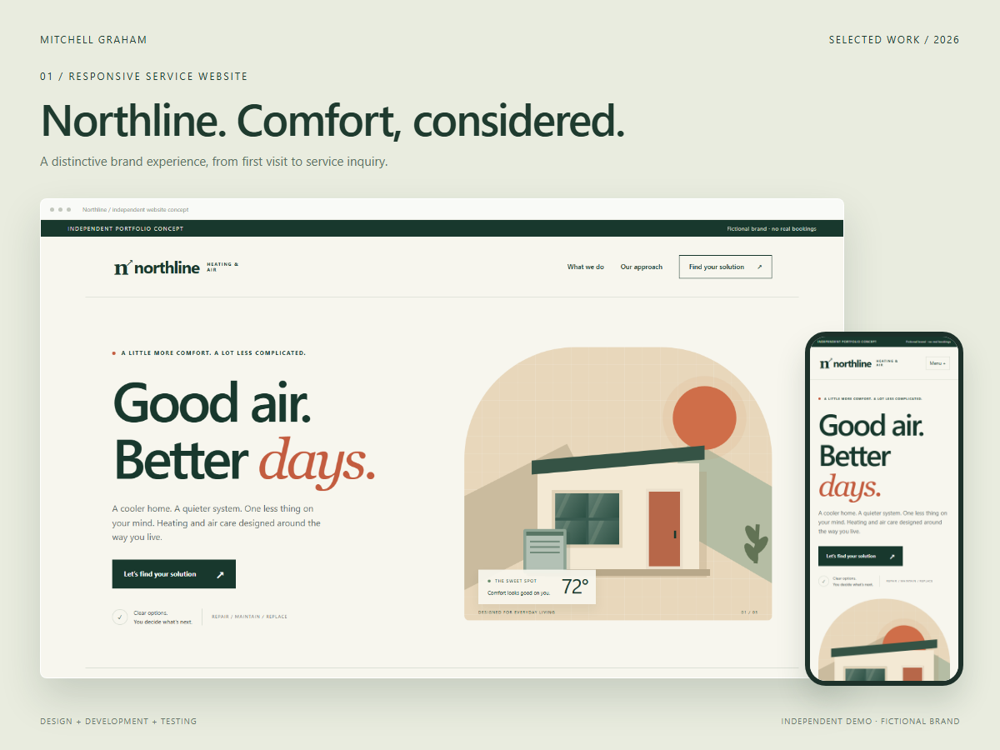

# Northline — responsive service website

[Try the interactive demo](https://mjgraham713.github.io/northline-demo/) · [Read the case study](assets/case-study.pdf)

A fictional home-services website with original CSS illustration, responsive navigation, service selection, and a validated inquiry preview.



## Try it

1. Select **Plan maintenance** to preselect the inquiry type.
2. Enter a test name and email, then preview the request.
3. Resize to a narrow screen and open the mobile navigation.

## Run locally

From this directory, with Python 3 installed:

```sh
python -m http.server 8000 --bind 127.0.0.1
```

Open http://127.0.0.1:8000/. No production dependencies, API keys, or build step. Use HTTP for JavaScript modules rather than opening files directly.

## Verification

Browser checks cover desktop and 390px mobile layouts and the interactions described above. They are representative checks, not a complete accessibility audit or cross-browser certification.

## Scope and limitations

The brand is fictional. The form sends no email and makes no booking. This is custom HTML/CSS/JavaScript, not a native Webflow project.

## Authorship

Independent portfolio concept by Mitchell Graham, developed with AI assistance. This is a demonstration, not a paid client engagement. No client data or proprietary assets are included. Public source is provided for inspection; no additional reuse license is granted.
